<p align="center">
  
</p>

<h1 align="center">Cuadra</h1>

**Finanzas personales que se cuadran solas.** Cuadra lee tus bancos panameños, tus avisos por correo y tus facturas, y mantiene en una sola página tus saldos, tus gastos, tus tarjetas y lo que otras personas te deben, sin que tengas que anotar nada a mano.

Corre en un servidor propio y pequeño (una Raspberry Pi o un VPS de 1 GB), sin servicios de terceros para tus datos y sin IA en el proceso.

<p align="center">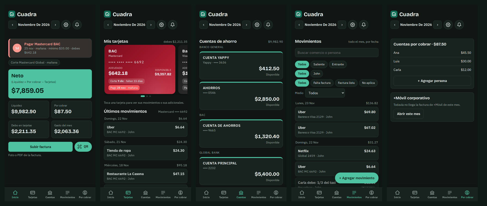</p>

<p align="center"><sub>Capturas con datos de demostración inventados.</sub></p>

---

## Recorrido por las pantallas

Cuadra es una sola página que se instala como app en el teléfono. Abajo hay cinco pestañas; arriba, el mes que estás viendo y la campana de avisos. Estas capturas usan datos de demostración inventados.

<table>
<tr>
<td width="230" valign="top">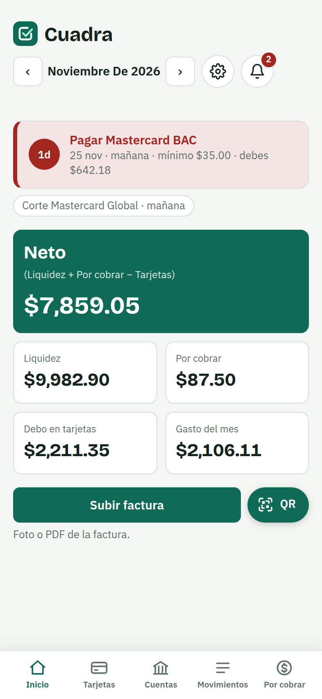</td>
<td valign="top">

### Inicio: cómo estás hoy
- **Neto** = Liquidez + Por cobrar − Tarjetas. Es el número que importa: lo que realmente tienes si hoy cobras y pagas todo.
- Debajo, cuatro cifras: **Liquidez** (lo que hay en tus cuentas), **Por cobrar** (lo que te deben), **Debo en tarjetas** y **Gasto del mes**.
- Arriba aparece el próximo pago de tarjeta, con los días que faltan, el mínimo y lo que debes, y el próximo corte.
- **Subir factura** acepta una foto o un PDF. El botón **QR** lee el código de una factura de la DGI.
</td></tr>
<tr>
<td width="230" valign="top">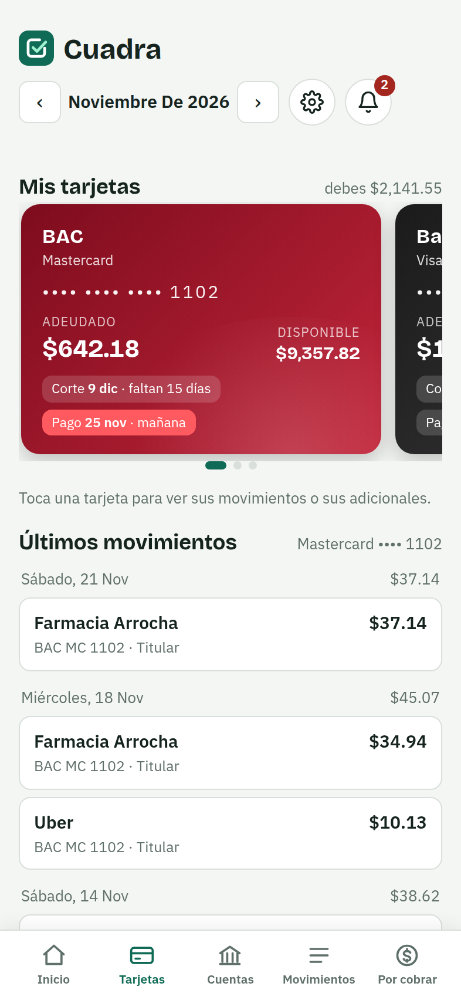</td>
<td valign="top">

### Tarjetas
- Un carrusel con una tarjeta por cada una que tienes. Cada una muestra lo **adeudado**, lo **disponible**, el **corte** y el **pago**, con los días que faltan.
- Al tocar una tarjeta ves sus últimos movimientos y los de sus adicionales.
- Las compras de una tarjeta adicional se asignan a su titular y se suman a lo que debe.
</td></tr>
<tr>
<td width="230" valign="top">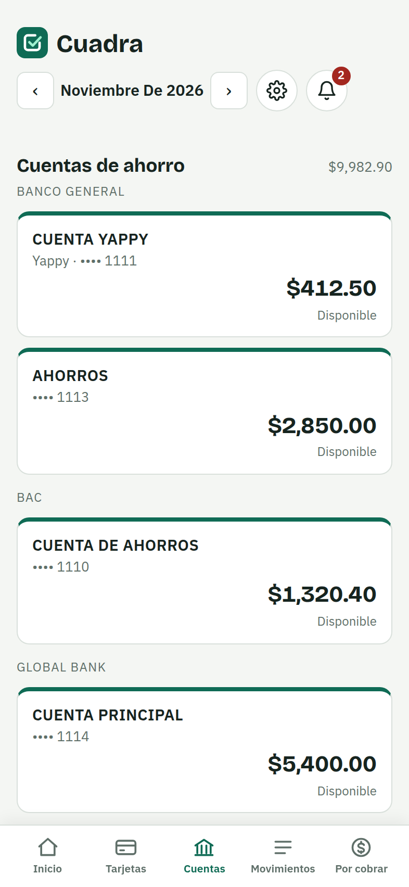</td>
<td valign="top">

### Cuentas
- Tus cuentas de ahorro agrupadas por banco, con el saldo disponible de cada una y el total arriba.
- Es la cifra de **Liquidez** del Inicio, desglosada. Los saldos salen de lo que dice la banca en línea, no de lo que tú anotes.
</td></tr>
<tr>
<td width="230" valign="top">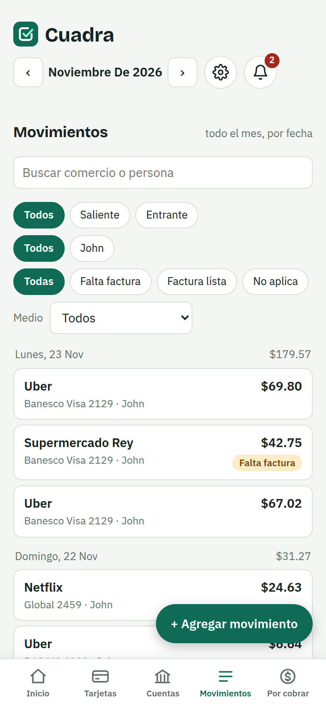</td>
<td valign="top">

### Movimientos
- Todo lo del mes, agrupado por día, con el total de cada día.
- Un buscador (comercio o persona) y filtros: **Saliente** o **Entrante**, por persona, por estado de la factura (**Falta factura**, **Factura lista**, **No aplica**) y por tarjeta o cuenta.
- Casi todo llega solo, desde el correo y desde el banco. Para lo que no llegó, el botón **Agregar movimiento**.
- Tocar un movimiento lo abre para corregirlo.
</td></tr>
<tr>
<td width="230" valign="top">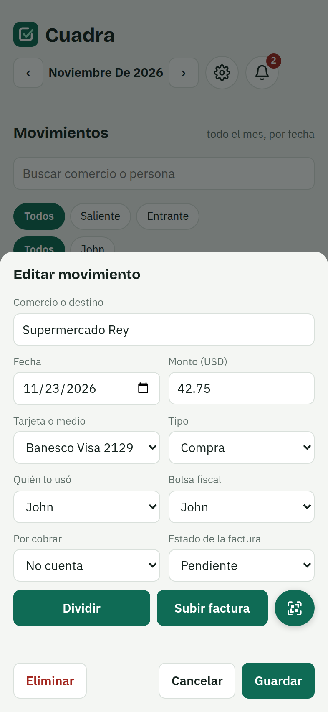</td>
<td valign="top">

### Editar un movimiento
- Comercio, fecha, monto, tarjeta o cuenta, tipo, quién lo usó y de qué bolsa fiscal sale.
- **Por cobrar** marca el movimiento a nombre de una persona. **Estado de la factura** dice si la tiene, si falta o si no aplica.
- Tres botones: **Dividir** (repartirlo entre varias personas), **Subir factura** (foto o PDF) y el ícono del **QR**.
</td></tr>
<tr>
<td width="230" valign="top">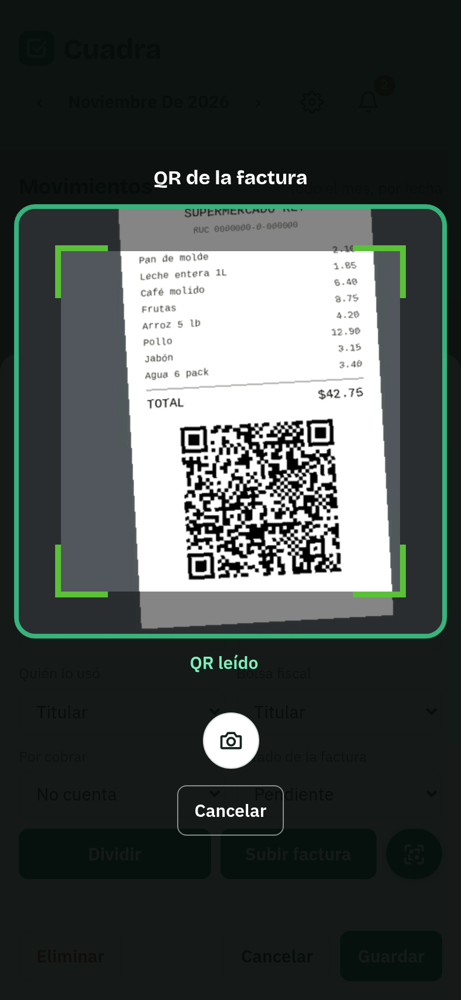</td>
<td valign="top">

### Escanear el QR de una factura
- Apuntas la cámara al QR impreso en la factura. Se lee solo, sin tocar nada más.
- Cuadra va a la DGI de Panamá con ese código, trae la factura, la pega al movimiento (que pasa a **Factura lista**) y la guarda en Google Drive.
- Si la DGI todavía no la publicó, queda **en espera** y se vuelve a buscar sola a las 2 horas, al día siguiente, a los 3 días, a los 7 días y a fin de mes.
- Si el QR no se lee, la foto queda como la factura.
</td></tr>
<tr>
<td width="230" valign="top">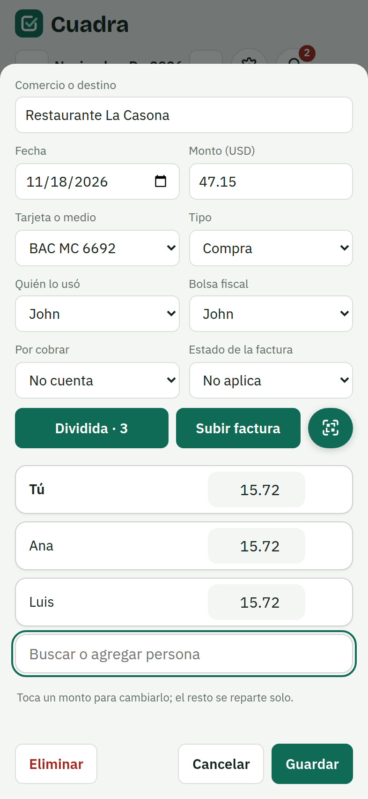</td>
<td valign="top">

### Dividir una cuenta
- Escribes el nombre de cada persona con quien dividiste y se agrega. El monto se reparte en partes iguales.
- Tocas un monto para cambiarlo y el resto se reparte solo.
- Cada parte queda como deuda de esa persona y tu parte sigue siendo un gasto tuyo, así que nada se cuenta doble.
</td></tr>
<tr>
<td width="230" valign="top">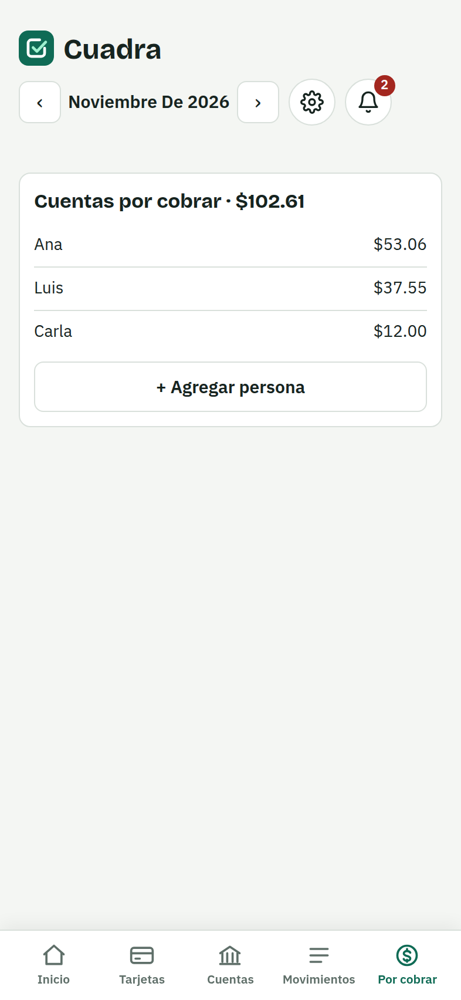</td>
<td valign="top">

### Por cobrar
- Cada persona con lo que te debe y el total arriba. Aquí se ve el resultado de la división de arriba.
- Lo que debe cada una sale de los movimientos marcados a su nombre. Cuando paga (un Yappy recibido) o hace un abono, la deuda baja sola.
- **Agregar persona** crea a alguien nuevo.
</td></tr>
<tr>
<td width="230" valign="top">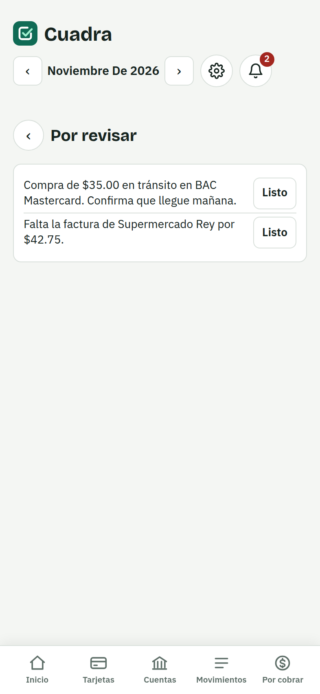</td>
<td valign="top">

### Avisos («Por revisar»)
- La campana junta lo que Cuadra no pudo resolver sola: una compra en tránsito que debe confirmarse con el banco, una factura que falta, algo que no cuadra.
- Cada aviso tiene un botón **Listo** para quitarlo cuando ya lo revisaste.
</td></tr>
</table>

## Las facturas: por qué importan y cómo se pegan

**Por qué importan.** En Panamá, la declaración de renta de una persona natural permite deducir ciertos gastos. Según la [DGI](https://dgi.mef.gob.pa/DInforme/D-IsRenta): gastos médicos, gastos escolares, intereses hipotecarios sin interés preferencial, intereses de préstamos del IFARHU y aportes a un fondo de jubilación privada. Los asalariados que quieren una devolución de impuestos también tienen que presentar la declaración, y la DGI da como fecha límite el 15 de marzo (con prórroga hasta el 15 de abril). Las guías contables que revisé coinciden en lo práctico: hay que conservar los comprobantes de esos gastos durante todo el año.

El problema es la acumulación. Un año son cientos de compras, en varios bancos y a veces de varias personas, y en marzo nadie recuerda qué factura era de qué compra. La factura que no aparece es plata que se deja en la mesa. Cuadra existe, en buena parte, para que en marzo cada factura ya esté pegada a su compra y guardada.

> Esto no es asesoría fiscal. Los topes y las reglas cambian: confírmalos con la [DGI](https://dgi.mef.gob.pa) o con un contador.

**Cómo es una factura en Panamá.** La factura electrónica trae un QR (en el comprobante impreso, el CAFE) y un código único, el **CUFE**. La DGI deja consultarla en su portal con cualquiera de los dos ([preguntas frecuentes](https://dgi.mef.gob.pa/_7facturaelectronica/fpreguntas)). En ventas a consumidor final, el emisor puede mandarla al PAC al final del día, así que a veces la DGI tarda en tenerla.

**Cómo las pega Cuadra.**

1. **Escaneas el QR**, desde el movimiento o desde Inicio sin elegir ninguno. Cuadra va a la DGI con ese código y baja el PDF y los datos: emisor, RUC, número, fecha, total e ITBMS.
2. **Si la DGI todavía no la publicó**, la factura queda en espera y se busca sola: a las 2 horas, al día siguiente, a los 3 días, a los 7 días y a fin de mes. Si nunca aparece, avisa para que subas el PDF o una foto.
3. **Busca a qué compra pertenece** (el *match*): el mismo monto exacto, con fecha a ±3 días, en una compra que todavía no tenga factura. Ignora transferencias y movimientos excluidos, y las compras de una tarjeta adicional solo se pegan a su titular.
4. **Si hay una sola candidata, la pega.** Si hay varias, el parecido entre el nombre del emisor y el del comercio desempata. Si aun así no se decide, no adivina: lo deja en «Por revisar» para que lo elijas tú.
5. **Si la compra todavía no llegó del banco**, la factura espera hasta 7 días. A las 24 horas ya se archiva en Google Drive con el nombre `fecha_comercio_monto`, en una carpeta por persona y año, así que cada quien tiene sus facturas listas para su propia declaración.
6. **Una factura nunca crea un movimiento.** Los saldos solo los mueven transacciones reales. Si el total de la factura no coincide con el del movimiento, se anota en el movimiento. Y una misma factura (el mismo CUFE) no se guarda dos veces.

## Funciones

| | |
|---|---|
| **Movimientos al instante** | Cada aviso de compra que llega al correo (BAC, Banesco, Global Bank, Banco General, Yappy) se registra en menos de 5 minutos. |
| **Conciliación diaria con el banco** | Un lector entra a la banca en línea una vez al día, confirma saldos y movimientos y detecta compras **en tránsito**. Lo que no cuadra se marca para revisión. |
| **Tarjetas de crédito** | Saldo, disponible, fechas de corte y de pago, pago mínimo y pago de contado, con aviso de los pagos próximos. |
| **Tarjetas adicionales** | Las compras de cada adicional se asignan a su titular y se suman a lo que debe; sus pagos por Yappy se descuentan solos. Cada persona tiene su propio acceso y solo ve lo suyo. |
| **Cuentas por cobrar** | Cada compra que usó otra persona queda a su nombre. Sus pagos (por ejemplo un Yappy) y los abonos bajan la deuda. Una cuenta se puede dividir entre varias personas. |
| **Facturas** | Por PDF, foto o código QR de la DGI de Panamá; se emparejan con su movimiento (mismo monto, ±3 días) y se archivan en Google Drive, listas para la declaración de renta. Ver [Las facturas](#las-facturas-por-qué-importan-y-cómo-se-pegan). |
| **Respaldos** | Copia diaria completa en Google Drive y del código en Git. Una máquina nueva se monta con un solo comando. |

## Cómo funciona

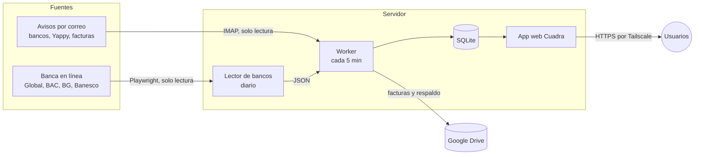

1. **Tiempo real:** el *worker* lee el correo por IMAP, interpreta cada aviso y aplica las reglas (quién gastó, de qué bolsillo sale, si es reembolso o cobro).
2. **Confirmación diaria:** el lector de bancos entrega un JSON con saldos, movimientos y compras en tránsito; el *worker* lo concilia con lo que llegó por correo y luego lo borra.
3. **Consulta:** la app web muestra todo por persona y por tarjeta; el administrador ve todo, cada titular de adicional solo lo suyo.

## Seguridad

- **Solo lectura frente a los bancos.** El lector nunca paga, transfiere ni cambia configuración. Las únicas acciones permitidas en cada banco están escritas en el código, y cualquier botón ambiguo se rechaza antes de tocarlo.
- **Datos en tu servidor.** Base de datos SQLite local; Drive solo guarda respaldos y facturas.
- **Claves fuera del código.** Usuarios y contraseñas viven en archivos con permiso `600` que no entran al repositorio (`credenciales.env.nosync`, `config.toml`, `secretos.json`).
- **Acceso.** Contraseñas con *scrypt*, sesiones firmadas, bloqueo tras intentos fallidos y publicación por Tailscale.

## Estructura

```
lector-bancos/
  bancos.py              Lector de banca en línea (Playwright + Chromium en xvfb)
  parsers.py             Interpretación del texto de cada página
  correr.sh              Corrida diaria y entrega a la app
  restaurar.sh           Instalación completa en una máquina nueva desde el respaldo
  credenciales.env.nosync.example

app-cuadra/
  gastos/worker.py       Revisión periódica del correo y de la carpeta de entrada
  gastos/reglas.py       Reglas: adicionales, cobros, flotantes, conciliación
  gastos/parsers.py      Avisos de cada banco y Yappy
  gastos/facturas*.py    Facturas por PDF, foto y QR de la DGI
  gastos/web.py          API y autenticación (FastAPI)
  gastos/static/calculo.js  Cálculo de saldos, liquidez y fechas: UNA copia, usada por la página y por el servidor (vía node)
  gastos/resumen.py      Resumen (Neto, tarjetas, cuentas) para el asistente; solo da formato, el cálculo está en calculo.js
  gastos/static/         Interfaz (una sola página, instalable como app)
  deploy/                Servicios systemd y configuración de ejemplo
```

## Instalación

Requisitos: Ubuntu 24.04 o Raspberry Pi OS 64 bits, Python 3.11+, Node.js 18+ (los saldos, el Neto y las fechas de tarjetas se calculan en un solo archivo, `gastos/static/calculo.js`, que usan la página y el servidor), una cuenta de Gmail con contraseña de aplicación y, opcionalmente, Google Drive (rclone) y Tailscale.

```bash
# App web y worker
cd app-cuadra
bash instalar.sh                         # crea el entorno, los servicios y el comando `gastos`
nano ~/gastos-datos/config.toml          # correo, Drive y puerto
gastos usuario admin "Tu nombre" admin   # primer usuario

# Lector de bancos (como root, en /opt/bancos)
sudo cp -r ../lector-bancos /opt/bancos && cd /opt/bancos
sudo apt install -y xvfb
sudo python3 -m venv /opt/bancos-venv
sudo /opt/bancos-venv/bin/pip install playwright && sudo /opt/bancos-venv/bin/playwright install --with-deps chromium
sudo cp credenciales.env.nosync.example credenciales.env.nosync && sudo chmod 600 credenciales.env.nosync
sudo nano credenciales.env.nosync
sudo xvfb-run -a /opt/bancos-venv/bin/python bancos.py --solo bac --prueba   # prueba un banco, con capturas de cada paso
```

Luego programa `correr.sh` en el `cron` de root a la hora que prefieras.

## Adaptarlo a tus cuentas

Las tarjetas, cuentas y personas se definen en `app-cuadra/gastos/config.py` (`TARJETAS`, `ALIAS_MEDIOS`, `PERSONAS`) y en los identificadores del lector (`lector-bancos/bancos.py`). Los valores del repositorio son **ejemplos**.

## Limitaciones

- Los lectores dependen del diseño actual de cada banca en línea; si un banco cambia su página, hay que ajustar su lector.
- Hecho para bancos de Panamá y en español.
- Proyecto personal publicado como referencia; úsalo solo con tus propias cuentas y bajo tu responsabilidad.

## Licencia

Todos los derechos reservados ([LICENSE](LICENSE)): el código se puede ver, pero no copiar ni usar sin permiso.

## Autor

Creado por **John Batista** ([@KleverBatista-max](https://github.com/KleverBatista-max)): diseño, programación y pruebas.
