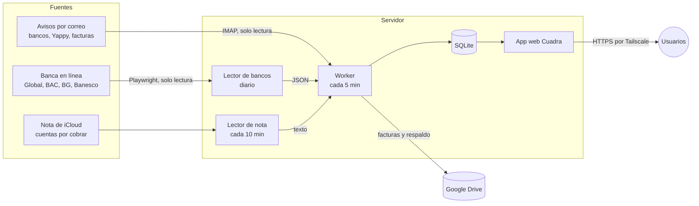

<p align="center">
  
</p>

<h1 align="center">Cuadra</h1>

**Finanzas personales que se cuadran solas.** Cuadra lee tus bancos panameños, tus avisos por correo y tus facturas, y mantiene en una sola página tus saldos, tus gastos, tus tarjetas y lo que otras personas te deben, sin que tengas que anotar nada a mano.

Corre en un servidor propio y pequeño (una Raspberry Pi o un VPS de 1 GB), sin servicios de terceros para tus datos y sin IA en el proceso.

---

## Funciones

| | |
|---|---|
| **Movimientos al instante** | Cada aviso de compra que llega al correo (BAC, Banesco, Global Bank, Banco General, Yappy) se registra en menos de 5 minutos. |
| **Conciliación diaria con el banco** | Un lector entra a la banca en línea una vez al día, confirma saldos y movimientos y detecta compras **en tránsito**. Lo que no cuadra se marca para revisión. |
| **Tarjetas de crédito** | Saldo, disponible, fechas de corte y de pago, pago mínimo y pago de contado, con aviso de los pagos próximos. |
| **Tarjetas adicionales** | Las compras de cada adicional se asignan a su titular y se suman a lo que debe; sus pagos por Yappy se descuentan solos. Cada persona tiene su propio acceso y solo ve lo suyo. |
| **Cuentas por cobrar** | Sincronizadas con una nota compartida de iPhone: agregar o borrar a alguien en la nota se refleja en la app, con un límite de seguridad ante lecturas dudosas. |
| **Facturas** | Por PDF, foto o código QR de la DGI de Panamá; se emparejan con su movimiento y se archivan en Google Drive. |
| **Respaldos** | Copia diaria completa en Google Drive y del código en Git. Una máquina nueva se monta con un solo comando. |

## Cómo funciona



1. **Tiempo real:** el *worker* lee el correo por IMAP, interpreta cada aviso y aplica las reglas (quién gastó, de qué bolsillo sale, si es reembolso o cobro).
2. **Confirmación diaria:** el lector de bancos entrega un JSON con saldos, movimientos y compras en tránsito; el *worker* lo concilia con lo que llegó por correo y luego lo borra.
3. **Consulta:** la app web muestra todo por persona y por tarjeta; el administrador ve todo, cada titular de adicional solo lo suyo.

## Seguridad

- **Solo lectura frente a los bancos.** El lector nunca paga, transfiere ni cambia configuración. Las únicas acciones permitidas en cada banco están escritas en el código, y cualquier botón ambiguo se rechaza antes de tocarlo.
- **Datos en tu servidor.** Base de datos SQLite local; Drive solo guarda respaldos y facturas.
- **Claves fuera del código.** Usuarios y contraseñas viven en archivos con permiso `600` que no entran al repositorio (`credenciales.env.nosync`, `config.toml`, `secretos.json`).
- **Acceso.** Contraseñas con *scrypt*, sesiones firmadas, bloqueo tras intentos fallidos y publicación por Tailscale.

## Estructura

```
lector-bancos/
  bancos.py              Lector de banca en línea (Playwright + Chromium en xvfb)
  parsers.py             Interpretación del texto de cada página
  icloud_nota.py         Lector de la nota de cuentas por cobrar en icloud.com
  correr.sh              Corrida diaria y entrega a la app
  restaurar.sh           Instalación completa en una máquina nueva desde el respaldo
  credenciales.env.nosync.example

app-cuadra/
  gastos/worker.py       Revisión periódica del correo y de la carpeta de entrada
  gastos/reglas.py       Reglas: adicionales, cobros, flotantes, nota, conciliación
  gastos/parsers.py      Avisos de cada banco, Yappy y +Móvil
  gastos/facturas*.py    Facturas por PDF, foto y QR de la DGI
  gastos/web.py          API y autenticación (FastAPI)
  gastos/static/         Interfaz (una sola página, instalable como app)
  deploy/                Servicios systemd y configuración de ejemplo
```

## Instalación

Requisitos: Ubuntu 24.04 o Raspberry Pi OS 64 bits, Python 3.11+, una cuenta de Gmail con contraseña de aplicación y, opcionalmente, Google Drive (rclone) y Tailscale.

```bash
# App web y worker
cd app-cuadra
bash instalar.sh                         # crea el entorno, los servicios y el comando `gastos`
nano ~/gastos-datos/config.toml          # correo, Drive y puerto
gastos usuario admin "Tu nombre" admin   # primer usuario

# Lector de bancos (como root, en /opt/bancos)
sudo cp -r ../lector-bancos /opt/bancos && cd /opt/bancos
sudo apt install -y xvfb
sudo python3 -m venv /opt/bancos-venv
sudo /opt/bancos-venv/bin/pip install playwright && sudo /opt/bancos-venv/bin/playwright install --with-deps chromium
sudo cp credenciales.env.nosync.example credenciales.env.nosync && sudo chmod 600 credenciales.env.nosync
sudo nano credenciales.env.nosync
sudo xvfb-run -a /opt/bancos-venv/bin/python bancos.py --solo bac --prueba   # prueba un banco, con capturas de cada paso
```

Luego programa `correr.sh` en el `cron` de root a la hora que prefieras (y `icloud_cron.sh` cada minuto si usas la nota).

## Adaptarlo a tus cuentas

Las tarjetas, cuentas y personas se definen en `app-cuadra/gastos/config.py` (`TARJETAS`, `ALIAS_MEDIOS`, `PERSONAS`) y en los identificadores del lector (`lector-bancos/bancos.py`). Los valores del repositorio son **ejemplos**.

## Limitaciones

- Los lectores dependen del diseño actual de cada banca en línea; si un banco cambia su página, hay que ajustar su lector.
- Hecho para bancos de Panamá y en español.
- Proyecto personal publicado como referencia; úsalo solo con tus propias cuentas y bajo tu responsabilidad.

## Licencia

[MIT](LICENSE)
